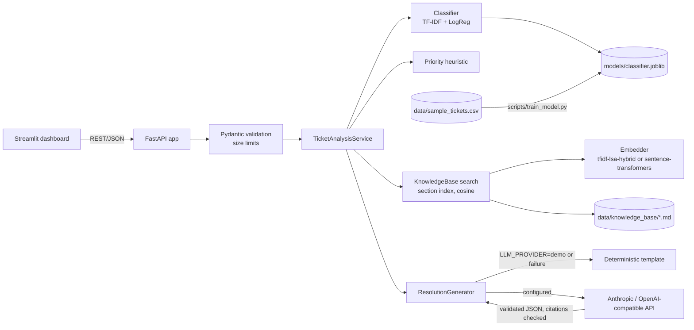

# Architecture

## Components

| Module | Responsibility |
|---|---|
| `app/main.py` | App factory, lifespan (builds services), body-size middleware, error envelope |
| `app/api/routes.py` | Endpoints; thin, delegates to services |
| `app/models/schemas.py` | All request/response models and input limits |
| `app/services/classifier.py` | Dataset loading, training, hold-out evaluation, persistence, inference, low-confidence logic |
| `app/services/priority.py` | Rule-based priority points |
| `app/retrieval/embeddings.py` | Embedder backends and fallback selection |
| `app/retrieval/knowledge_base.py` | Article parsing, section chunking, ranking, term-overlap guard |
| `app/services/llm.py` | Provider calls, prompt, output validation, deterministic fallback |
| `app/services/analysis.py` | Orchestrates one ticket through the pipeline |
| `app/services/container.py` | Builds long-lived services from settings |

## Design decisions

- **Factory app, services built in lifespan.** A failed startup (for example an empty knowledge base) does not crash the process; `/health` stays 200, `/ready` returns 503 with a safe reason, and ticket endpoints return 503.
- **Honest method labels.** The retrieval method name is part of every response. The default backend is a TF-IDF/LSA hybrid and says so; it is never called "embedding-based semantic search" unless a neural backend is actually loaded.
- **Grounding is enforced in code, not only in the prompt.** Every LLM step must cite an article ID from the retrieved set; anything else is rejected and the labelled fallback is used. Retrieval abstains below a score threshold, so unanswerable tickets get no steps and no citations instead of invented ones.
- **Article-level citations.** Retrieval ranks sections but returns whole articles; a citation refers to the article ID, and the matched section is returned alongside it.
- **Exact vector search.** With 75 passages, a matrix product is exact and faster than any index.
- **Predictions separate from user input.** Urgency and impact stay in `user_provided` and feed the priority heuristic, which has no labelled data to learn from.
- **No persistence of ticket content.** There is no database; logs omit ticket text.
- **Model lifecycle.** `scripts/train_model.py` is the reproducible path. The API also trains on first start if no valid artifact exists, so the app starts without manual steps.
- **Body-size limit via Content-Length.** Requests without it get 411 rather than being buffered unbounded.
